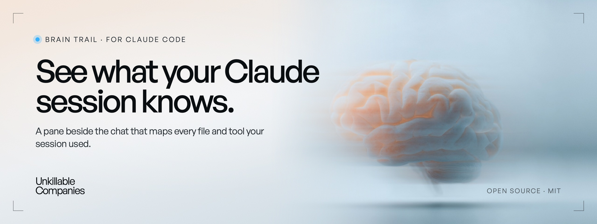
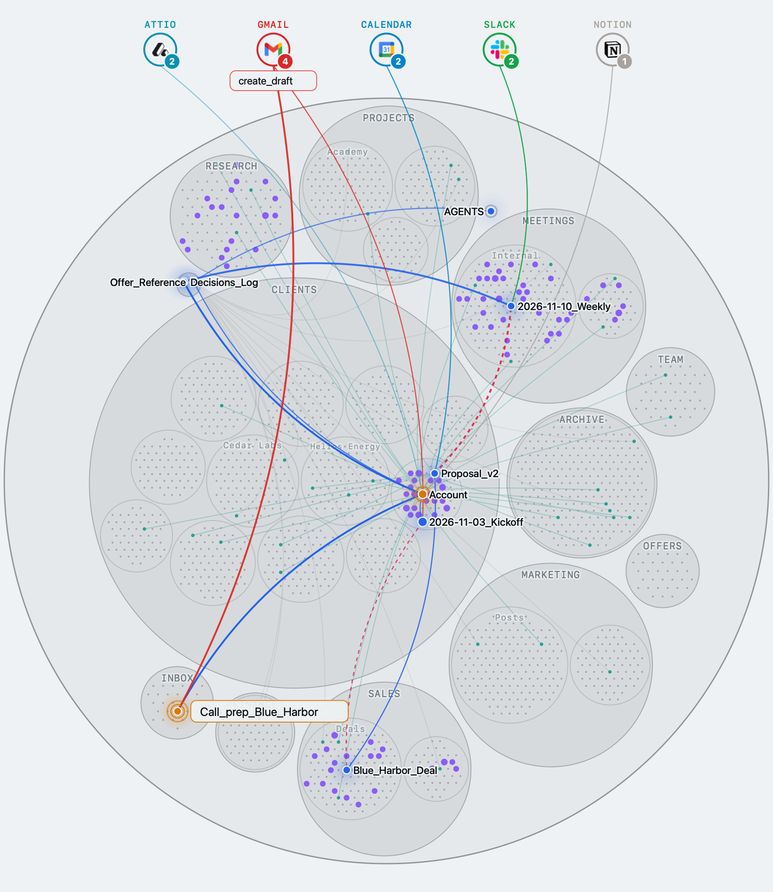

<p align="center">
  
</p>

# Brain Trail

A pane beside the Claude Code chat. It shows what your session put in front of the model: the files it read and wrote, the ones it only saw in a search or through a link, and the tools it called.

You see why Claude answers the way it does, what it never looked at, and when its context starts to work against you.

<p align="center">
<picture>
  <source media="(prefers-color-scheme: dark)" srcset="docs/map-dark.png">
  
</picture>
</p>

<sub>A session preparing a client call, on a demo company brain (made-up notes). Claude reads the account, the kickoff notes and the proposal, checks the CRM, the inbox and the calendar, then writes a call prep.</sub>

## Install (30 seconds)

### 1. Get the plugin

<details>
<summary><b>From a terminal</b></summary>

<br>

```bash
claude plugin install brain-trail-v2 --marketplace go-silex/brain-trail
```

Answer `y` to add the marketplace, then Enter for your user scope. The native CLI API has been exercised with Claude Code 2.1.321 and 2.1.322; earlier compatibility has not been established. Desktop end-to-end verification is a separate release gate.

</details>

<details>
<summary><b>From the Claude desktop app</b></summary>

<br>

1. Click **+** next to the prompt box, then **Plugins**.
2. **Add marketplace**: `go-silex/brain-trail`.
3. **Add plugin**: Brain Trail.

</details>

The plugin ships its browser assets and a Go relay for Linux, macOS and Windows on x64 and arm64. Claude users do not need to install Node, Bun or Go, or run an install-time build.

<details>
<summary><b>Update or remove</b></summary>

<br>

```bash
claude plugin update brain-trail-v2
```

```bash
claude plugin uninstall brain-trail-v2
```

Had an earlier copy in `~/.claude/mods/`? Remove it, or two panes open.

</details>

### 2. Open a new session

The pane opens by itself beside the chat, whatever the folder: a code project, an Obsidian vault, a client folder. Closed it? Type `/brain-trail-v2`.

The map is drawn in the desktop app. The terminal shows the text tabs only.

### Oh My Pi

With Oh My Pi 18.18.9, install a local checkout and start a new session:

```bash
omp install /path/to/brain-trail
```

Type `/brain-trail` to open the dashboard in your browser. Claude and OMP use the same views and controller: the native pane uses SVG and the browser offers WebGL. Both use the Go relay's application registry and the same opening-settings model, while each host retains its own settings. An optional context and cost band appears above the OMP input; you can turn it on or off in Settings.

ChatGPT is not supported yet.

## What the map shows

Your folder as one disc: one circle per folder, one dot per file. Every file that entered the context lights up.

| Colour | Means |
| --- | --- |
| 🔵 Blue | Read. Its content is in the context. |
| 🟠 Amber | Written or edited by Claude. |
| 🟣 Violet | Seen in a result: a search, a listing, a connector, a sub-agent's report. Only its name came in. |
| 🟢 Teal | Seen through a link in a note Claude read. Claude can follow it. |
| 🔴 Dashed red | A jump between two notes that no link joins. Adding the link helps the next session. |

The services Claude calls (Gmail, Slack, your CRM, Notion…) sit above the disc with their logo and their call count. The legend under the map counts each colour; click it to list the files.

Follow the session as it works, replay it step by step, and zoom with the wheel. The **3D** button changes the map's renderer; **Full screen** opens the shared interface in your browser. Replay, selected preview and follow/zoom state belong to the host session; camera, active tab and other presentation state remain local to each surface.

Opening the browser or a file reports that the launch was spawned or dispatched, not that the application opened it. A later opener-process error can be reported to the current session; it does not prove whether the document opened. File opens still require host consent.

In a docked Claude Desktop pane, every tab stays within the available height:
the header and footer remain fixed, and the map fits the space between them.
Long text tabs navigate inside their body with the wheel, page keys, or the
First, Previous, Next and Last page buttons. The host reports Home/End like
page keys, so use First/Last to jump to the ends. Extremely short panes ask you
to enlarge the pane; the full interface returns when space is available. Inline panes, the terminal
and the OMP dashboard retain their content-height layout. Desktop sizing uses
the host's cell measurements, so font and density settings affect pixel scale.
The map's Client holder uses a pane-height bound and Desktop's flex-shrink
behavior to match the allocated paint height.
The map image stretches across its allocated paint area on Desktop.
Fitted 3D activity glows are bounded so new reads and writes do not move the
camera. Hiding the map during a drag preserves its final orientation and
restores rotation only if it was running before the drag.

Inside an Obsidian vault, the map shows the whole vault, even when the session started in a sub-folder.

## The five tabs

- **Map**: the trail above.
- **Goal**: your request, Claude's plan, and what it did, in plain words.
- **Context**: how full the context window is and what to do about it (keep going, compact, start a new session), your plan usage and the session cost.
- **Files**: every file the session used, why it is there, and the links your notes are missing.
- **Coach**: tips on how the session went. **Apply** puts the suggestion in your prompt box.

English and French.

## Privacy

For Claude Code, Brain Trail keeps its local state in `~/.claude/brain-trail-v2`. For Oh My Pi, it stores settings, costs and captured tool-call data in its own SQLite database under the active agent profile's `brain-trail` directory, not in the host's authentication database. Captured inputs and results may contain session content; the same directory also holds workspace layout caches. Clearing the trail resets what is shown, not the stored data. No Brain Trail account or tracking.

When you ask for Coach analysis, the assistant analyzes the session on your own plan. Three.js 0.160.0 and the browser assets are bundled locally; the browser UI does not load Three or fonts from a CDN. See [SECURITY.md](SECURITY.md) for local access, consent and file boundaries.

## How it measures

- The context gauge is Claude Code's own figure, the one the status line shows. Right after a compaction it shows the `/context` estimate, marked ≈.
- What is loaded before your first message is the `/context` breakdown, computed locally.
- The weight of a tool result is estimated from its length, about 3.6 characters per token.

## Made by Unkillable Companies

We help business leaders rebuild how their company works with AI. The leader builds their own system first, then brings the company along. Brain Trail is the tool we use to see what our own company brain gives Claude.

[unkillablecompanies.com](https://unkillablecompanies.com) · [Unkillable Academy](https://academy.unkillablecompanies.com)

<details>
<summary><b>For contributors</b></summary>

<br>

See [CONTRIBUTING.md](CONTRIBUTING.md) for development checks, module interfaces, SDK updates and the evidence expected for changes to the views.

Report vulnerabilities privately using the contact in [SECURITY.md](SECURITY.md).

</details>

MIT license. `hooks/vendor/d3-hierarchy` is ISC. The browser bundle includes its third-party licenses; Go and x/sys licenses are in `hosts/relay/bin/`.
