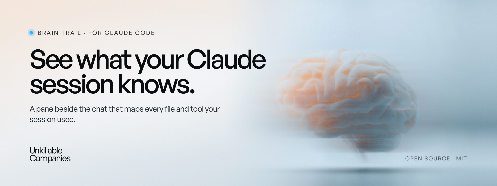
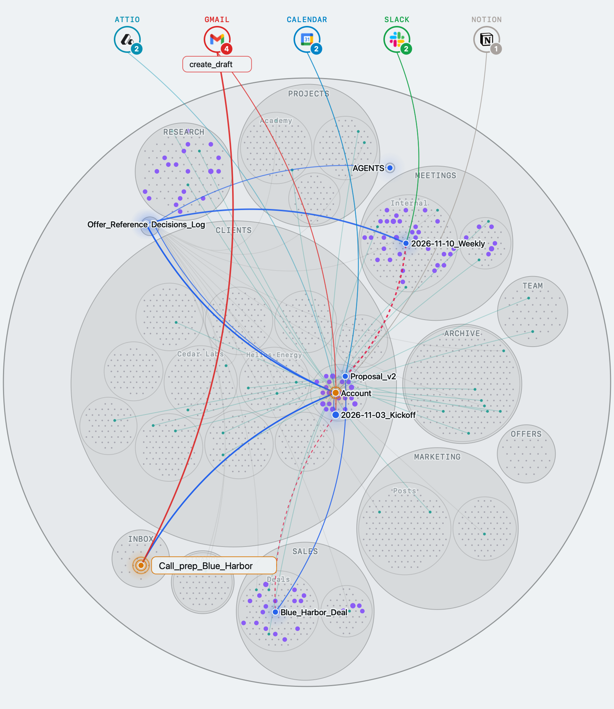

<p align="center">
  
</p>

# Brain Trail

Brain Trail shows what your native Claude Code or Oh My Pi session has seen: files it read or wrote, names found in searches or links, and tools it called. Open the dashboard in the Claude Desktop mod or a browser. The Chat MCP App views an explicitly paired native session; it does not automatically trace Chat.

You see why Claude answers the way it does, what it never looked at, and when its context starts to work against you.

<p align="center">
<picture>
  <source media="(prefers-color-scheme: dark)" srcset="docs/map-dark.png">
  
</picture>
</p>

<sub>A session preparing a client call, on a demo company brain (made-up notes). Claude reads the account, the kickoff notes and the proposal, checks the CRM, the inbox and the calendar, then writes a call prep.</sub>

## Install

### 1. Get the plugin

<details>
<summary><b>From a terminal</b></summary>

<br>

```bash
claude plugin install brain-trail-v2 --marketplace go-silex/brain-trail
```

Answer `y` to add the marketplace, then Enter for your user scope. The native CLI API has been exercised with Claude Code 2.1.321 and 2.1.322; earlier compatibility has not been established. Desktop end-to-end verification is a separate release gate.

</details>

<details>
<summary><b>From the Claude desktop app</b></summary>

<br>

1. Click **+** next to the prompt box, then **Plugins**.
2. **Add marketplace**: `go-silex/brain-trail`.
3. **Add plugin**: Brain Trail.

</details>

The plugin ships its browser assets and a Go relay for Linux, macOS and Windows on x64 and arm64. Claude users do not need to install Node, Bun or Go, or run an install-time build.

<details>
<summary><b>Update or remove</b></summary>

<br>

```bash
claude plugin update brain-trail-v2
```

```bash
claude plugin uninstall brain-trail-v2
```

Had an earlier copy in `~/.claude/mods/`? Remove it to avoid loading the plugin twice.

</details>

### 2. Choose a dashboard surface

Use **Open Brain Trail** in the Desktop prompt band to open the mod: the live 2D and 3D maps, Goal, Context, Files, Coach and Settings. Use the pane’s expand control to make more room. Opening the pane does not submit a model prompt, call MCP Browser or require the relay or a registered Desktop MCP server.

Press the **globe** in the widget to open the dashboard in the system’s default browser. The line below the buttons confirms when the opening request is handed off. For a different browser or a live Claude Browser tab, use **`/brain-trail-v2` → Copy link** and paste into its address bar, not the conversation. The private link expires shortly and works once; treat it like a password.

The native plugin captures activity and owns session state, permissions and files. The native pane shares the dashboard’s controls with the browser, and uses the packaged relay when needed for file preview, application discovery or external opening. The separately registered MCP App is for explicit Chat pairing.

### Desktop MCP App

The separate Desktop MCP server is only needed for the paired Chat App, not the native pane or browser handoff. It uses the matching shipped Go executable and App assets; it does not require end users to install Node, Bun or Go. For manual stdio configuration, register it under the key `brain-trail`, with the absolute executable path as command and `mcp` followed by the absolute App-assets directory as arguments. MCPB installation may assign a host-generated server name. Do not add a second server registration to the native plugin.

The App is a viewer/controller for a deliberately paired native Code or OMP session, not automatic tracing of a Chat conversation. The six binary targets cover Linux, macOS and Windows on x64 and arm64; target availability is not proof of host installation or sandbox compatibility. Actual host tool forwarding and pairing require separate verification. Browser and OMP launch instructions remain independent of this registration.

To view a native session in Chat, choose **Pair with Chat** in that session's native controls or browser dashboard. Paste the one-use envelope into the Brain Trail App's pairing field, not into the chat prompt. Detach before choosing another session. A restored view with missing private state remains detached; **Reset view** creates a fresh unpaired view, never automatic reconnection.

Inline, a paired App asks the host for a height derived from its width, about 900 px in a 736 px Claude Chat column, and stays within any maximum height the host announces. In 3D, **Full screen** uses the host's full-screen display mode when the host offers one, and the browser's full-screen mode otherwise.

### Oh My Pi

With Oh My Pi 18.18.9, install a local checkout and start a new session:

```bash
omp install /path/to/brain-trail
```

Type `/brain-trail` to open the same dashboard in your browser. OMP and Claude use the Go relay's application registry and the same opening-settings model, while each host retains its own settings. An optional context and cost band appears above the OMP input; you can turn it on or off in Settings.

ChatGPT is not supported yet.

## What the map shows

Your folder as one disc: one circle per folder, one dot per file. Every file that entered the context lights up.

| Colour | Means |
| --- | --- |
| 🔵 Blue | Read. Its content is in the context. |
| 🟠 Amber | Written or edited by Claude. |
| 🟣 Violet | Seen in a result: a search, a listing, a connector, a sub-agent's report. Only its name came in. |
| 🟢 Teal | Seen through a link in a note Claude read. Claude can follow it. |
| 🔴 Dashed red | A jump between two notes that no link joins. Adding the link helps the next session. |

The MCP services Claude calls (Gmail, Slack, your CRM, Notion…) appear on the map with their call counts. In the native 3D view, arcs connect activity to service badges. A badge shows the service’s logo when available and its initial otherwise. The legend under the map counts each colour; click it to list the files.

Follow the session as it works and replay it step by step. **3D** switches from the 2D map to an interactive 3D projection (SVG in the native mod, Three.js in the browser and paired App). Replay, selected preview and follow/zoom state belong to the host session; camera and active tab remain local to each view.

3D requires WebGL in the browser hosting the dashboard. If WebGL is unavailable, a notice preserves access to the rest of the dashboard: choose **2D** or use a browser with WebGL. Where supported, check the host's graphics acceleration settings.

Dashboard navigation:

| Gesture | 2D | 3D |
| --- | --- | --- |
| Wheel | Zoom toward the pointer | Zoom toward the pointer |
| Middle-button vertical drag | Zoom out when dragging down, in when dragging up | Same |
| Left-button drag | Move the map | Turn the scene |
| Right-button drag | Move the map | Move the scene without turning it |

Only a left click opens a note; pressing several mouse buttons together never opens one. Wheel zoom during a drag is retained when the drag continues. Manual navigation stops following Claude; a drag pauses automatic rotation and restores the prior rotation choice when it ends. The **⤢** control in the 3D toolbar fits the scene back into view. Resetting either view preserves the other view's camera.

Browser 3D adapts to the theme: dark mode uses restrained ambient connections and activity glows; light mode retains its point rendering without bloom.

The globe and file-open actions report that an opener was spawned or dispatched, not that an application opened. A later opener-process error can be reported to the current session. Copying a link never opens it. Brain Trail previews known session paths and opens them in allowed applications without an additional confirmation, including known paths outside the workspace.

The browser dashboard adapts to its available space. Resizing and fit behavior should be checked in the actual browser surface used with the host.

Inside an Obsidian vault, the map shows the whole vault, even when the session started in a sub-folder.

## The five tabs

- **Map**: the trail above.
- **Goal**: your request, Claude's plan, and what it did, in plain words.
- **Context**: how full the context window is and what to do about it (keep going, compact, start a new session), your plan usage and the session cost.
- **Files**: every file the session used, why it is there, and the links your notes are missing.
- **Coach**: tips on how the session went. **Apply** puts the suggestion in your prompt box.

English and French.

## Privacy

For Claude Code, Brain Trail keeps its local state in `~/.claude/brain-trail-v2`. For Oh My Pi, it stores settings, costs and captured tool-call data in its own SQLite database under the active agent profile's `brain-trail` directory, not in the host's authentication database. Captured inputs and results may contain session content; the same directory also holds workspace layout caches. Clearing the trail resets what is shown, not the stored data. No Brain Trail account or tracking.

When you ask for Coach analysis, the assistant analyzes the session on your own plan. Three.js 0.160.0 and the browser assets are bundled locally; the browser UI does not load Three or fonts from a CDN. See [SECURITY.md](SECURITY.md) for local access and file boundaries.

## How it measures

- The context gauge is Claude Code's own figure, the one the status line shows. Right after a compaction it shows the `/context` estimate, marked ≈.
- What is loaded before your first message is the `/context` breakdown, computed locally.
- The weight of a tool result is estimated from its length, about 3.6 characters per token.

## Made by Unkillable Companies

We help business leaders rebuild how their company works with AI. The leader builds their own system first, then brings the company along. Brain Trail is the tool we use to see what our own company brain gives Claude.

[unkillablecompanies.com](https://unkillablecompanies.com) · [Unkillable Academy](https://academy.unkillablecompanies.com)

<details>
<summary><b>For contributors</b></summary>

<br>

See [CONTRIBUTING.md](CONTRIBUTING.md) for development checks, module interfaces, SDK updates and the evidence expected for changes to the views.

Report vulnerabilities privately using the contact in [SECURITY.md](SECURITY.md).

</details>

MIT license. `hooks/vendor/d3-hierarchy` is ISC. Web bundles include third-party notices; Go, MCP SDK and linked-module licenses are in `hosts/relay/bin/` and the MCPB archives.
